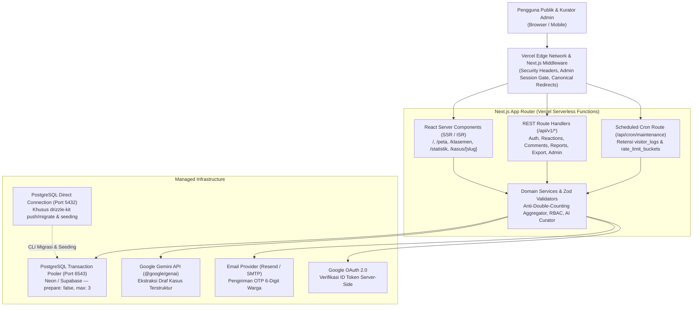

# 02 — Arsitektur Sistem & Spesifikasi Teknis (Next.js + Vercel + PostgreSQL)

> **Prinsip Arsitektur:** *Server-first, Stateless, Type-safe End-to-End, ISR-Cached Public Pages, Isolated Admin Portal.*

---

## 1. Diagram Arsitektur High-Level



---

## 2. Tech Stack Terkunci & Rasional Pemilihan

| Layer | Teknologi | Versi Target | Alasan Pemilihan di v2.0 |
|---|---|---|---|
| **Framework Full-Stack** | Next.js (App Router) | `^15.3` | Mendukung RSC, SSR/ISR per halaman `/kasus/[slug]`, metadata SEO & OpenGraph dinamis, serta API Route Handlers terintegrasi di Vercel. |
| **UI Library & Bahasa** | React + TypeScript | `19.x` / `~5.8` | *Strict mode* (`strict: true`), *Server Components* untuk mengurangi *JS bundle* di sisi klien. |
| **Styling** | Tailwind CSS v4 | `^4.1` | Konfigurasi `@theme` CSS-first, performa kompilasi cepat, desain token terpusat. |
| **Database & Ekstensi** | PostgreSQL + `pg_trgm` | `15+` / `16+` | Mendukung *fuzzy search* indeks GIN, agregasi analitik kompleks, serta tipe data `NUMERIC(20, 2)` presisi tinggi untuk nilai Rupiah triliunan. |
| **ORM & Migrasi** | Drizzle ORM + `postgres` | `^0.45` / `^3.4` | *Zero-overhead* SQL builder, kompatibel dengan *serverless transaction pooler* (`prepare: false`), dan aman terhadap SQL Injection. |
| **Validasi Skema** | Zod | `^4.x` | Validasi seragam untuk *environment variables*, *request payload*, query filter, dan *structured output* AI. |
| **Autentikasi & Kripto** | `jose` + `bcryptjs` + `google-auth-library` | Terbaru | `jose` berbasis Web Crypto API (kompatibel Edge Middleware & Node runtime) untuk JWT dalam `HttpOnly` Cookie. |
| **Visualisasi & Ikon** | Recharts + Lucide React + Custom SVG Map | `^3.x` / `^0.5x` | Grafik tren & sektor responsif, peta choropleth SVG 38 provinsi yang dapat diakses keyboard & screen reader. |
| **AI Assistant** | `@google/genai` | `^2.4` | Ekstraksi terstruktur untuk modul AI Curator admin (hanya dipanggil server-side). |
| **Pengujian** | Vitest + Playwright | Terbaru | Pengujian unit aturan hukum/finansial, integrasi API, dan *E2E smoke test* alur kritis. |

---

## 3. Struktur Direktori Target Proyek v2.0

```text
korup.indo/
├── .env.example                       # Template environment variables produksi v2.0
├── next.config.ts                     # Security headers, image domains, konfigurasi build
├── drizzle.config.ts                  # Konfigurasi Drizzle Kit (memakai DIRECT_URL)
├── tsconfig.json                      # TypeScript strict mode + path alias @/*
├── package.json
├── vitest.config.ts
│
├── docs/                              # [DIPERTAHANKAN] Dokumentasi pra-produksi & arsitektur
├── data/                              # [DIPERTAHANKAN] Dataset riset kanonik 1945–2026 (JSON/CSV/SQL)
│
├── public/
│   ├── indonesia-38-provinces.geojson # Aset GeoJSON 38 provinsi
│   ├── favicon.svg / .png / .ico
│   └── og-image.png / .svg
│
└── src/
    ├── env.ts                         # Validasi env Zod (fail-fast saat startup jika variabel wajib hilang)
    ├── middleware.ts                  # Proteksi rute /admin/*, security headers, normalisasi request
    │
    ├── app/
    │   ├── layout.tsx                 # Root layout, next/font/google, JSON-LD WebSite/Dataset
    │   ├── globals.css                # Tailwind v4 @theme tokens & scrapbook utility classes
    │   ├── robots.ts                  # Dynamic robots.txt (Disallow /admin, /api)
    │   ├── sitemap.ts                 # Dynamic sitemap.xml dari database kasus & tokoh
    │   ├── opengraph-image.tsx        # Default OG image generator
    │   │
    │   ├── (public)/                  # Route group halaman publik (memakai Navbar, DisclaimerBanner, Footer)
    │   │   ├── layout.tsx
    │   │   ├── page.tsx               # Beranda (/) — ISR + tag 'cases', 'stats', 'settings'
    │   │   ├── peta/page.tsx          # Peta Interaktif 38 Provinsi (/peta)
    │   │   ├── klasemen/page.tsx      # Klasemen Liga: Pejabat, Partai, Korporasi (/klasemen)
    │   │   ├── statistik/page.tsx     # Dasbor Analitik Tren, Era, Sektor, Asset Recovery (/statistik)
    │   │   ├── cari/page.tsx          # Mesin Pencari Kasus Lanjutan (/cari)
    │   │   ├── kasus/[slug]/
    │   │   │   ├── page.tsx           # Detail Berkas Perkara SSR/ISR + JSON-LD + Komunitas
    │   │   │   └── opengraph-image.tsx# Dynamic OG Card per perkara (judul, status hukum, kerugian)
    │   │   ├── tokoh/[slug]/page.tsx  # Profil Individu, Jabatan, Partai & Histori Perkara
    │   │   ├── lapor/page.tsx         # Kanal Laporan Warga, Hak Jawab & Pelacakan Tiket
    │   │   └── open-data/page.tsx     # Portal Unduh Dataset Terbuka (CSV/JSON) & Kamus Data
    │   │
    │   ├── admin/                     # Route group Portal Kurasi Admin (Tema Investigation Board)
    │   │   ├── login/page.tsx         # Halaman login staf admin (tanpa hardcoded credentials)
    │   │   ├── (protected)/
    │   │   │   ├── layout.tsx         # Admin Sidebar Layout + Verifikasi Sesi Server
    │   │   │   ├── page.tsx           # Dashboard Overview Admin
    │   │   │   ├── cases/page.tsx     # Manajemen Perkara + Verdicts + Financials + Timeline
    │   │   │   ├── persons/page.tsx   # Manajemen Tokoh, Jabatan & Partai
    │   │   │   ├── companies/page.tsx # Manajemen Korporasi Rekanan
    │   │   │   ├── ai-curator/page.tsx# Asisten Kurator AI Human-in-the-Loop
    │   │   │   ├── review-queue/page.tsx # Antrean Verifikasi & Disparitas Sumber
    │   │   │   ├── reports/page.tsx   # Moderasi Laporan Warga & Hak Jawab
    │   │   │   ├── comments/page.tsx  # Moderasi Komentar Publik
    │   │   │   ├── settings/page.tsx  # Manajemen Pengumuman Hukum & QRIS Donasi
    │   │   │   ├── users/page.tsx     # Manajemen Staf Admin (Khusus super_admin)
    │   │   │   ├── audit-logs/page.tsx# Jejak Audit Perubahan Data
    │   │   │   └── monitoring/page.tsx# Metrik Trafik Anonim & Kesehatan Sistem
    │   │
    │   └── api/
    │       ├── health/route.ts        # Health check DB & app status
    │       ├── cron/maintenance/route.ts # Pembersihan visitor_logs >30 hari & expired buckets
    │       └── v1/                    # Seluruh REST API v1 terstandarisasi
    │           ├── cases/...
    │           ├── officials/...
    │           ├── parties/...
    │           ├── provinces/...
    │           ├── companies/...
    │           ├── stats/...
    │           ├── export/...
    │           ├── reports/...
    │           ├── comments/...
    │           ├── auth/citizen/...
    │           └── admin/...
    │
    ├── components/                    # Komponen UI Modular (Public, Charts, Map, Community, Admin)
    ├── data/
    │   └── provincesGeo.ts            # Poligon SVG 38 provinsi (dipertahankan & disempurnakan a11y)
    ├── lib/                           # Utilitas murni: formatters.ts, slugify.ts, constants.ts, fetcher.ts
    └── server/
        ├── db/
        │   ├── index.ts               # Drizzle client (Transaction Pooler safe)
        │   ├── schema.ts              # Unified Drizzle Schema v2.0
        │   ├── seed.ts                # Seeder idempoten dari data/normalized/
        │   └── bootstrap-admin.ts     # CLI pembuatan akun super_admin awal yang aman
        ├── repositories/              # Query SQL terenkapsulasi (casesRepo, statsRepo, dll.)
        ├── services/                  # Logika bisnis: financialAggregator, cacheInvalidator, mailer, aiCurator
        ├── auth/                      # session.ts (jose HttpOnly cookies), rbac.ts, password.ts
        ├── security/                  # rateLimit.ts (Postgres-backed), ipHash.ts, sanitize.ts
        └── validators/                # Kumpulan skema Zod v4
```

---

## 4. Strategi Rendering, Caching & Serverless Database

### 4.1 Strategi Rendering & Revalidasi Cache (ISR)
| Rute | Strategi Rendering | Cache / Revalidasi |
|---|---|---|
| `/`, `/peta`, `/klasemen`, `/statistik` | Server Components + `unstable_cache` | `revalidate: 300` (5 menit) + tag invalidasi instan (`cases`, `stats`, `settings`) saat Admin melakukan mutasi data. |
| `/kasus/[slug]`, `/tokoh/[slug]` | Dynamic SSR + ISR (`revalidate = 600`) | Revalidasi per tag `case:[id]` saat admin memperbarui putusan atau warga mengirim reaksi/komentar. |
| `/cari` | Dynamic Server Component (`force-dynamic`) | Query langsung ke PostgreSQL menggunakan indeks GIN `pg_trgm` sesuai parameter `?q=&province=&era=&status=&sector=&page=`. |
| `/admin/*` | Dynamic (`force-dynamic`) | Tanpa cache publik (`Cache-Control: no-store`); divalidasi oleh `middleware.ts` dan *Server Layout* sebelum render. |

### 4.2 Manajemen Koneksi Database di Vercel Serverless
1. **Runtime Queries (`DATABASE_URL`):** Menggunakan *Transaction Pooler* (Neon Pooler atau Supabase PgBouncer port `6543`) dengan konfigurasi:
   - `prepare: false` (wajib untuk *transaction pooling*).
   - `max: 3` per instance serverless agar tidak menghabiskan *connection limit* database saat lonjakan trafik.
   - `idle_timeout: 20`, `connect_timeout: 10`.
2. **Migrasi & Seeding (`DIRECT_URL`):** Menggunakan koneksi langsung non-pooler (port `5432`) khusus pada `drizzle.config.ts` dan skrip CLI `bun run db:push` / `bun run db:seed`.

### 4.3 Pengiriman Email OTP Warga (Stateless)
Pada v1, kode OTP sempat hanya dicetak ke `console.log` di development. Di v2.0:
- Integrasi `src/server/services/mailer.ts` mendukung **Resend API** (rekomendasi utama Vercel) atau **SMTP** standar.
- Jika `RESEND_API_KEY` belum diisi di mode lokal (`NODE_ENV=development`), OTP tetap dicatat di log terminal pengembangan, tetapi di produksi (`NODE_ENV=production`) konfigurasi email wajib aktif sebelum fitur registrasi email lokal diizinkan.
