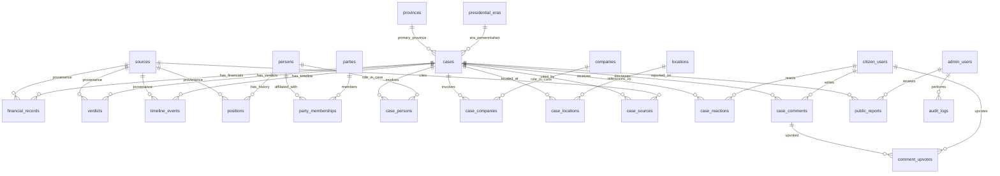

# 03 — Skema Database Terpadu & Tata Kelola Data (Drizzle ORM + PostgreSQL)

> **Tujuan:** Mengakhiri duplikasi antara `server/db/schema.ts` (v1 aplikasi) dan `data/schema/schema.sql` (skema riset kanonik). Seluruh data historis `data/normalized/*.json` dipetakan langsung ke satu skema Drizzle ORM terpadu di `src/server/db/schema.ts`.

---

## 1. Entity Relationship Diagram (ERD) Terpadu



---

## 2. Ekstensi PostgreSQL Wajib

Sebelum migrasi skema dijalankan, database target wajib mengaktifkan:
```sql
CREATE EXTENSION IF NOT EXISTS "pg_trgm";
CREATE EXTENSION IF NOT EXISTS "pgcrypto";
```

---

## 3. Definisi Enum PostgreSQL

| Nama Enum | Nilai Valid | Sumber / Catatan |
|---|---|---|
| `legal_status` | `penyelidikan`, `penyidikan`, `tersangka`, `terdakwa`, `dituntut`, `divonis_bersalah`, `divonis_inkrah`, `banding`, `kasasi`, `peninjauan_kembali`, `bebas`, `lepas`, `meninggal`, `status_tidak_diketahui` | Mengikuti standar riset penuh `data/schema/schema.sql`. |
| `financial_category` | `court_recognized_loss_amount`, `prosecutor_loss_amount`, `audit_loss_amount`, `alleged_loss_amount`, `bribe_amount`, `gratification_amount`, `illegal_profit_amount`, `restitution_amount`, `fine_amount`, `project_value`, `contract_value`, `assets_seized_value`, `assets_recovered_value` | Diskriminator Anti Double-Counting. |
| `fact_classification` | `FACT_PRIMARY`, `FACT_SECONDARY`, `PROSECUTOR_CLAIM`, `DEFENDANT_CLAIM`, `MEDIA_REPORT`, `COURT_FINDING`, `ANALYTICAL_DERIVATION`, `UNVERIFIED` | Klasifikasi derajat pembuktian fakta. |
| `verification_status` | `VERIFIED_PRIMARY`, `VERIFIED_MULTIPLE_SOURCES`, `VERIFIED_SECONDARY`, `PARTIALLY_VERIFIED`, `NEEDS_REVIEW`, `UNVERIFIED` | Status verifikasi kuratorial. |
| `court_level` | `tingkat_pertama`, `banding`, `kasasi`, `peninjauan_kembali` | Hierarki peradilan Indonesia. |
| `source_type` | `court_decision`, `court_document`, `indictment`, `prosecution_document`, `official_press_release`, `audit_document`, `government_document`, `company_document`, `reputable_media`, `other` | Tipe dokumen rujukan. |
| `sector_category` | `pengadaan_barang_jasa`, `bansos_bencana`, `suap_gratifikasi`, `perizinan_sda_tambang`, `mafia_peradilan`, `perbankan_keuangan`, `bumn_korporasi`, `pajak_bea_cukai`, `penyalahgunaan_anggaran` | Kategori makro untuk visualisasi grafik sektor. |
| `reaction_type` | `geram`, `rampok`, `memalukan`, `didukung`, `khilaf_administrasi`, `dimaklumi`, `tebang_pilih`, `kawal_sidang` | 8 sentimen reaksi warga. |
| `report_type` | `koreksi_data`, `rujukan_putusan_baru`, `usulan_kasus_baru`, `hak_jawab` | Ditambah `hak_jawab` untuk kepatuhan hukum pers. |
| `report_status` | `pending_review`, `approved`, `rejected` | Status antrean moderasi. |
| `admin_role` | `super_admin`, `admin`, `editor`, `moderator`, `auditor`, `reviewer` | 6 peran RBAC staf LKI. |
| `audit_action` | `create`, `update`, `delete`, `rollback`, `approve_report`, `reject_report`, `update_setting`, `moderate_comment` | Jejak audit permanen. |

---

## 4. Spesifikasi Tabel Terpadu

### 4.1 Tabel Referensi & Provenance
1. **`provinces`**: `id` (PK, contoh `'dki-jakarta'`, `'nasional'`), `name`, `island_cluster`, `geojson_code`, `cached_total_cases`, `cached_total_loss` (`NUMERIC(20,2)`).
2. **`presidential_eras`**: `id` (PK: `'era-orla'` s/d `'era-prabowo'`), `name`, `sort_order` (1–10), `start_date`, `end_date`, `cabinet_name`, `context_summary`.
3. **`parties`**: `id` (UUID/text PK), `name` (UNIQUE), `abbreviation` (UNIQUE), `color_hex`, `logo_url`.
4. **`sources`**: `id` (UUID PK), `source_title`, `source_url` (UNIQUE/indexed), `source_type`, `source_institution`, `publication_date`, `access_date`, `source_page`, `source_excerpt`, `source_reliability` (`high` | `medium` | `low`), `created_at`.

### 4.2 Tabel Entitas & Perkara Inti
5. **`persons`**: `id` (UUID PK), `slug` (UNIQUE, untuk `/tokoh/[slug]`), `full_name` (GIN `pg_trgm`), `normalized_name`, `aliases` (`text[]`), `gender` (`L`/`P`), `birth_place`, `birth_date`, `occupation`, `nationality`, `photo_url`, `created_at`, `updated_at`.
6. **`positions`**: `id` (UUID PK), `person_id` (FK → `persons`), `position_title`, `institution`, `government_level`, `sector`, `province_id` (FK → `provinces` nullable), `city_regency`, `period_start`, `period_end`, `position_at_offense` (boolean), `position_at_arrest` (boolean), `position_at_verdict` (boolean), `source_id` (FK → `sources`).
7. **`party_memberships`**: `id` (UUID PK), `person_id` (FK → `persons`), `party_id` (FK → `parties`), `party_position`, `membership_start`, `membership_end`, `party_status`, `party_at_offense` (boolean), `party_at_arrest` (boolean), `party_at_verdict` (boolean), `source_id` (FK → `sources`).
8. **`companies`**: `id` (UUID PK), `slug` (UNIQUE), `name` (GIN `pg_trgm`), `company_type`, `industry`, `business_sector`, `company_location`, `beneficial_owner`, `beneficial_owner_source`, `beneficial_owner_verification_status`, `company_status`, `source_id` (FK → `sources`).
9. **`locations`**: `id` (UUID PK), `province_id` (FK → `provinces`), `city_regency`, `district`, `latitude`, `longitude`, `location_type`.
10. **`cases`**:
    - `id` (UUID PK), `slug` (UNIQUE, untuk `/kasus/[slug]`), `case_title` (GIN `pg_trgm`), `normalized_case_title`, `case_number` (indexed).
    - Klasifikasi: `era_id` (FK → `presidential_eras`), `primary_province_id` (FK → `provinces`), `sector_category` (`sector_category` enum), `sector_label`, `sub_sector`, `primary_mode`, `secondary_modes` (`text[]`).
    - Tanggal siklus peradilan: `case_date`, `investigation_date`, `suspect_date`, `indictment_date`, `trial_start_date`, `verdict_date`, `final_decision_date`.
    - Status & ringkasan: `current_legal_status` (`legal_status` enum), `summary` (GIN `pg_trgm`), `charges_articles`, `verification_status`, `confidence_level`, `possible_duplicate`, `needs_manual_review`, `verification_note`.
    - Kolom agregasi terhitung (*read-optimized*, diperbarui hanya oleh `financialAggregator.ts`):
      - `display_loss_amount` (`NUMERIC(20, 2) DEFAULT 0`): angka kerugian negara resmi sesuai hierarki Anti Double-Counting.
      - `display_loss_basis` (`TEXT`): penjelasan basis angka (misal `'Putusan Inkrah'`, `'Audit Resmi BPKP (Belum Inkrah)'`, `'Perkara Suap/Gratifikasi'`).
      - `display_bribe_amount` (`NUMERIC(20, 2) DEFAULT 0`).
      - `display_recovery_amount` (`NUMERIC(20, 2) DEFAULT 0`): `restitution + fine + assets_recovered/seized` (tanpa duplikasi).
    - Metadata kurasi: `verified_by` (FK → `admin_users`), `verified_at`, `created_at`, `updated_at`.
11. **`case_persons`**: `id` (UUID PK), `case_id` (FK → `cases`), `person_id` (FK → `persons`), `is_primary_subject` (boolean), `role_in_case`, `legal_status`, `offense_role`, `defendant_role`, `source_id` (FK → `sources`), UNIQUE `(case_id, person_id)`.
12. **`case_companies`**: `id` (UUID PK), `case_id` (FK → `cases`), `company_id` (FK → `companies`), `company_role_in_case`, `transaction_value` (`NUMERIC(20,2)`), `contract_value` (`NUMERIC(20,2)`), `transaction_date`, `company_case_status`, `source_id`, UNIQUE `(case_id, company_id)`.
13. **`case_locations`**: `id` (UUID PK), `case_id`, `location_id`, `location_context`, UNIQUE `(case_id, location_id)`.
14. **`case_sources`**: `case_id` (FK → `cases`), `source_id` (FK → `sources`), `is_primary` (boolean), PK `(case_id, source_id)`.

### 4.3 Tabel Fakta Finansial, Putusan & Linimasa
15. **`financial_records`**: `id` (UUID PK), `case_id` (FK → `cases`), `person_id` (FK → `persons` nullable), `financial_type` (`financial_category`), `amount` (`NUMERIC(20,2)`), `currency` (`VARCHAR(10) DEFAULT 'IDR'`), `financial_year`, `financial_description`, `fact_classification`, `source_id` (FK → `sources`, **NOT NULL**), `source_page`, `verification_status`, `created_at`.
16. **`verdicts`**: `id` (UUID PK), `case_id` (FK → `cases`), `person_id` (FK → `persons`), `court`, `court_level`, `decision_number`, `decision_date`, `decision_type`, `guilty_status` (`bersalah` | `bebas` | `lepas`), `sentence_type`, `prison_sentence_months`, `prosecutor_demand_months` (integer nullable — pembanding tuntutan jaksa), `fine_amount` (`NUMERIC(20,2)`), `fine_substitute_sentence`, `restitution_amount` (`NUMERIC(20,2)`), `restitution_substitute_sentence`, `additional_penalty`, `asset_forfeiture`, `political_disqualification`, `is_final` (boolean), `source_id` (FK → `sources`, **NOT NULL**).
17. **`timeline_events`**: `id` (UUID PK), `case_id` (FK → `cases`), `event_date`, `event_type`, `event_description`, `institution`, `location`, `source_id` (FK → `sources`), `source_page`.

### 4.4 Tabel Partisipasi Warga & Pengaturan Situs
18. **`citizen_users`**: `id` (UUID PK), `username` (UNIQUE), `display_name`, `email` (UNIQUE), `password_hash`, `photo_url`, `origin_province`, `origin_city`, `bio`, `avatar_seed`, `is_email_verified` (boolean), `email_verification_code_hash`, `email_verification_expires`, `google_id` (UNIQUE nullable), `auth_provider` (`local` | `google`), `created_at`, `updated_at`.
19. **`case_reactions`**: `id` (UUID PK), `case_id`, `user_id`, `reaction_type`, `created_at`, UNIQUE `(case_id, user_id)`.
20. **`case_comments`**: `id` (UUID PK), `case_id`, `user_id`, `reaction_type` (nullable), `content`, `upvotes_count`, `is_hidden` (boolean), `moderated_by` (FK → `admin_users`), `moderation_reason`, `created_at`.
21. **`comment_upvotes`**: `id` (UUID PK), `comment_id`, `user_id`, `created_at`, UNIQUE `(comment_id, user_id)`.
22. **`public_reports`**: `id` (UUID PK), `tracking_code` (UNIQUE, contoh `'LKI-2026-9F2A'`), `case_id` (FK nullable), `report_type`, `description`, `reference_url`, `submitter_contact_encrypted` (nullable), `metadata` (`jsonb`), `status`, `moderator_note`, `reviewed_by` (FK → `admin_users`), `created_at`, `reviewed_at`.
23. **`site_settings`**: `key` (PK: `'announcement'` | `'donation'`), `value` (`jsonb`), `updated_by` (FK → `admin_users`), `updated_at`. *(Menggantikan file lokal `announcement.json` & `donation.json` secara permanen).*

### 4.5 Tabel Operasional, Keamanan & Audit
24. **`admin_users`**: `id` (UUID PK), `username` (UNIQUE), `password_hash`, `full_name`, `email`, `role` (`admin_role`), `is_active` (boolean), `failed_login_attempts`, `locked_until`, `last_login`, `created_at`.
25. **`review_queue`**: `id` (UUID PK), `entity_type`, `entity_id`, `reason`, `disparity_details`, `conflicting_sources` (`text[]`), `status` (`pending` | `resolved` | `needs_field_inquiry`), `resolved_by`, `created_at`, `resolved_at`.
26. **`audit_logs`**: `id` (UUID PK), `admin_user_id`, `entity_type`, `entity_id`, `action` (`audit_action`), `diff_snapshot` (`jsonb`), `ip_hash`, `created_at`.
27. **`rate_limit_buckets`**: `key` (PK, format `tier:ipHash`), `count`, `reset_at` (indexed untuk Vercel Cron).
28. **`visitor_logs`**: `id` (UUID PK), `timestamp`, `method`, `path`, `status_code`, `duration_ms`, `ip_hash` (SHA-256 + daily salt, tanpa IP mentah), `device_type`, `browser`, `os`, `referrer`, `session_id`.

---

## 5. Aturan Agregasi Finansial (Anti-Double-Counting SQL Rule)

Untuk mencegah penjumlahan ganda pada dasbor Peta, Klasemen, dan Statistik, fungsi layanan `computeCaseDisplayFinancials(caseId)` menerapkan aturan deterministik berikut:

1. **Kerugian Keuangan Negara (`display_loss_amount`):**
   - **Prioritas 1:** Jika ada record `court_recognized_loss_amount` (putusan pengadilan), gunakan nilai tersebut (`display_loss_basis = 'Putusan Pengadilan'`). Jika terdapat beberapa putusan berjenjang (PN → Kasasi → PK), gunakan putusan berkekuatan hukum tertinggi (`is_final = true`).
   - **Prioritas 2:** Jika tidak ada `court_recognized_loss_amount`, cek `audit_loss_amount` (hasil audit resmi BPK/BPKP). Tandai `display_loss_basis = 'Audit Resmi BPK/BPKP'`.
   - **Prioritas 3:** Jika perkara belum diputus dan belum ada audit BPK/BPKP, cek `prosecutor_loss_amount` atau `alleged_loss_amount`. Nilai ini **disimpan untuk tampilan kartu detail** dengan label tegas *"Dugaan Penyidik/Jaksa (Belum Terbukti)"*, dan **tidak dijumlahkan ke dalam Hall of Shame Inkrah**.
   - **Pengecualian Keras:** `project_value` dan `contract_value` **tidak pernah** masuk ke `display_loss_amount`.
2. **Suap & Gratifikasi (`display_bribe_amount`):**
   - Menjumlahkan `bribe_amount + gratification_amount + illegal_profit_amount` terpisah dari kerugian negara.
3. **Pemulihan Aset (`display_recovery_amount`):**
   - Menjumlahkan `restitution_amount + fine_amount + max(assets_recovered_value, assets_seized_value)` per kasus agar aset disita yang kemudian diperhitungkan sebagai uang pengganti tidak terhitung dua kali saat tercatat terpisah.

---

## 6. Pipeline Seeding Idempoten (`db:seed`)

Skrip `src/server/db/seed.ts` akan membaca 13 file kanonik di `data/normalized/*.json` secara berurutan sesuai *foreign key*:
1. Inisialisasi master **38 Provinsi + `nasional`** dan **10 Era Kepresidenan** (`era-orla` s/d `era-prabowo`).
2. Impor `sources.json`, `parties.json`, `locations.json`, `companies.json`, `persons.json`.
3. Impor `positions.json`, `party_memberships.json`, `cases.json` (dengan pembuatan `slug` deterministik agar URL stabil), `case_persons.json`, `case_companies.json`, `case_locations.json`.
4. Impor `financial_records.json`, `verdicts.json`, `timeline_events.json`.
5. Jalankan `recomputeAllCaseAggregates()` untuk mengisi `display_loss_amount`, `provinces.cached_total_*`, dan `site_settings` default.
6. Operasi menggunakan `ON CONFLICT DO UPDATE / DO NOTHING` sehingga aman dijalankan berulang kali (*idempotent*).
